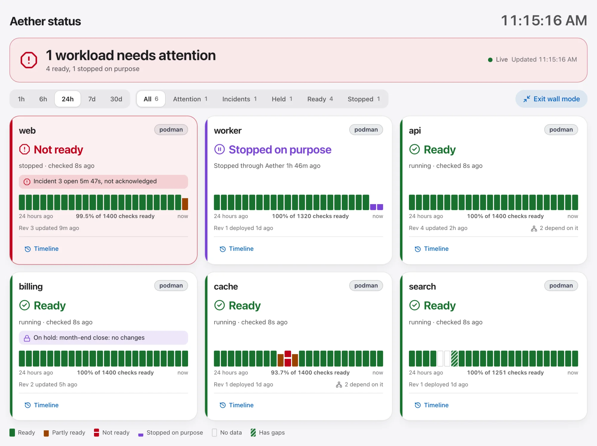
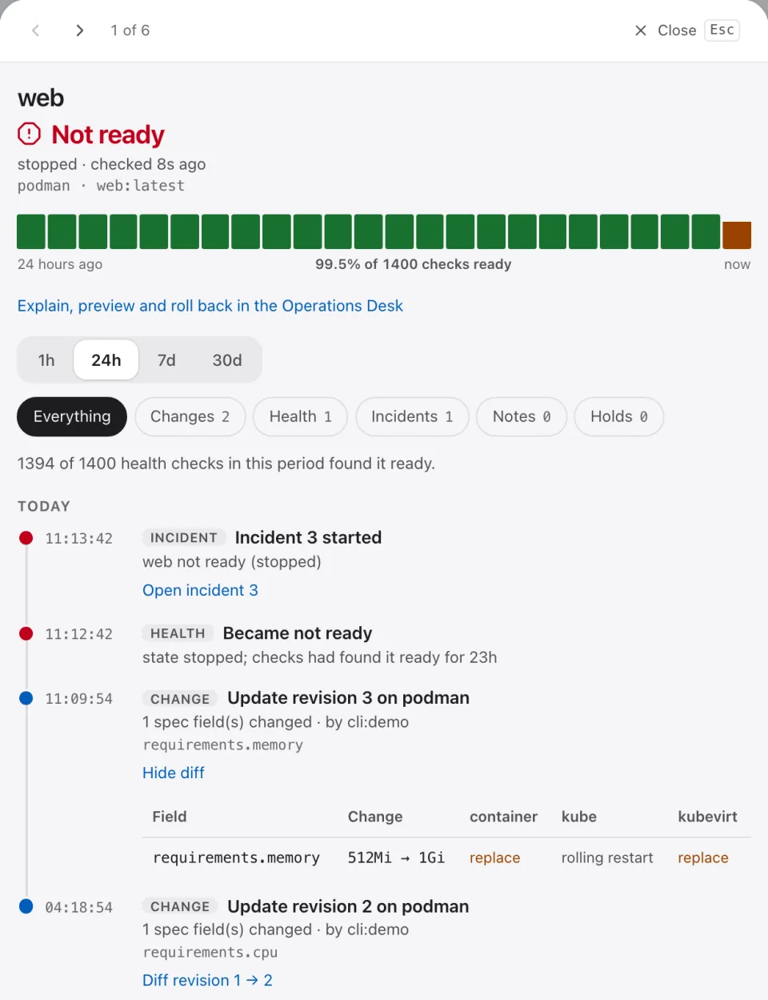
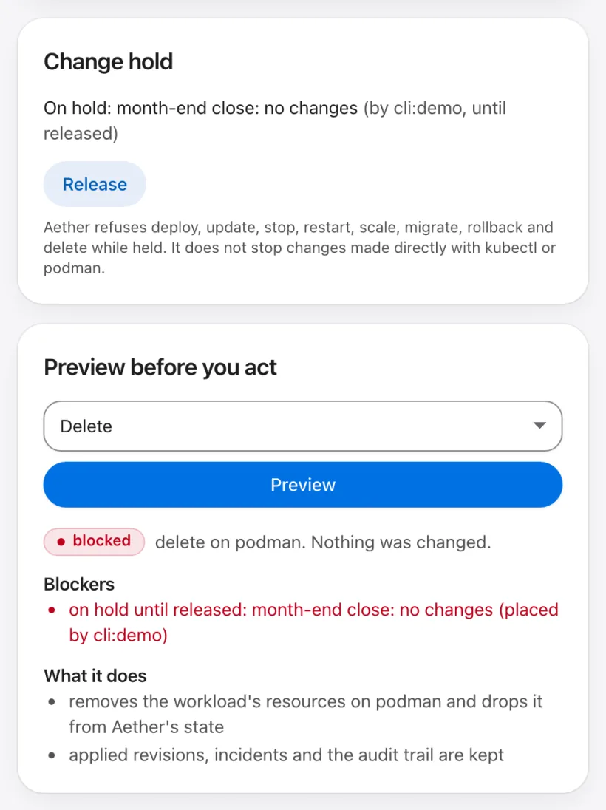

<div align="center">

<h1>
  <picture>
    <source media="(prefers-color-scheme: dark)" srcset="docs/assets/readme/aether-lockup-dark.svg">
    
  </picture>
</h1>

<h3>One workload spec for Podman, Kubernetes and KubeVirt.</h3>

<p>Deploy it, see what each runtime would ignore, move it between them, and watch it afterwards.</p>

[](https://github.com/zyvorai/Aether/actions/workflows/ci.yml)
[](LICENSE)
[](https://zyvorai.github.io/Aether/documentation/)

**[Product page](https://zyvorai.github.io/Aether/)** ·
**[Documentation](https://zyvorai.github.io/Aether/documentation/)** ·
**[Quick start](#quick-start)** ·
**[Limits](#runtime-support-and-limits)** ·
**[30-day trial](mailto:sales@zyvor.dev?subject=Aether%2030-day%20trial)**

<br>

<picture>
  <source media="(prefers-color-scheme: dark)" srcset="docs/assets/marketing/board-wall-dark.webp">
  
</picture>

<sub>The status board in wall mode. The real dashboard, showing sample data.</sub>

<br><br>

<sub>A <a href="https://zyvor.dev"> Zyvor</a> product</sub>

</div>

> [!IMPORTANT]
> Aether is **source-available, not open source**. Under the [Zyvor Production Licence v2.0](LICENSE), a paid Order is required before you copy, build, install, run, modify or deploy it, whatever the purpose. A 30-day trial is available on request from [sales@zyvor.dev](mailto:sales@zyvor.dev) (a paid evaluation Order at no charge). See [Licence and pricing](#licence-and-pricing).

## What it does

| | |
|---|---|
| **One spec** | An `aether/v1` Workload file describes the build, the resources, the network and the runtimes allowed |
| **Portability check** | `aether portability` shows which of your fields each runtime honours, honours partly or ignores, without contacting a runtime |
| **Explained placement** | `aether decide --explain` scores the allowed runtimes on cost, performance, reliability and availability, with reasons |
| **Migration** | Immediate, blue-green, rolling or canary moves between runtimes with health checks, and node-to-node KubeVirt live migration |
| **Status board** | A live tile per managed workload: observed state, uptime strip, open incidents and holds ([guide](docs/guides/operations/STATUS-BOARD.md)) |
| **Operations desk** | Incidents, change feed, action previews, change holds, spec revisions with rollback, reports ([guide](docs/guides/operations/OPERATIONS-DESK.md)) |
| **Four surfaces** | Command line, terminal UI, web dashboard, and a REST API with server-sent events and Prometheus metrics |
| **Governance** | Admin / Operator / Viewer roles, OIDC / SAML / LDAP sign-in, hash-checked audit trail, AES-256-GCM secrets |

## The whole contract

```yaml
apiVersion: aether/v1
kind: Workload
metadata:
  name: demo-webserver
  owner: team
  project: demo
build:
  context: "."
  dockerfile: Dockerfile
  registry: localhost
requirements:
  cpu: "500m"
  memory: 256Mi
  storage: 1Gi
runtime:
  preferred: auto
  allow: [container, kube, kubevirt]   # container = Podman
network:
  service: true
  ports:
    - containerPort: 8080
      servicePort: 80
```

Every field: [Workload schema](docs/reference/SCHEMA.md).

## Quick start

You need an Order first (see above), a Linux or macOS host, a current stable Rust toolchain, Node.js with npm for the dashboard, and the runtimes you want to target.

**1. Build from source.** No release binaries are published at the time of writing.

```bash
git clone https://github.com/zyvorai/Aether.git && cd Aether
(cd web/dashboard && npm ci && npm run build)   # the dashboard is embedded in the binary
cargo build --release
sudo install -m 0755 target/release/aether /usr/local/bin/aether
```

**2. Write a spec and check it.** Nothing is deployed in this step.

```bash
mkdir ../hello && cd ../hello
aether init                  # writes workload.yaml (name: hello-world)
aether validate
aether lint
aether portability
aether decide --explain
```

**3. Deploy and look.** This needs Podman, and a `Dockerfile` in this directory for an app that listens on port 8080.

```bash
aether run --runtime podman
aether list
aether status hello-world
aether logs hello-world
aether serve                 # dashboard and API on http://127.0.0.1:5090 (Ctrl+C to stop)
```

> [!WARNING]
> `aether serve` has a local demo login enabled by default; its credentials are documented in [`src/local_auth.rs`](src/local_auth.rs). Before anyone else can reach the server, set `AETHER_DEMO_AUTH=0`, or your own `AETHER_DEMO_USER` and `AETHER_DEMO_PASSWORD`.

**4. Move it, then clean up.** The target cluster must be reachable and able to pull the image (set `build.registry` to a registry it can reach, and `build.push: true`).

```bash
aether migrate hello-world kube --strategy blue-green
aether delete hello-world
```

Longer walk-throughs: [Installation](docs/getting-started/01-Installation.md) · [Quick Start](docs/getting-started/02-Quick-Start.md) · [CLI reference](docs/guides/cli/CLI-Reference.md)

## Operate

```bash
aether attention                            # open incidents, failed operations, unapplied spec edits
aether changes --since 24h                  # one feed of deploys, operations, warnings and incidents
aether timeline hello-world --since 7d      # everything recorded about one workload
aether incidents show 1                     # an incident and the changes before it
aether explain hello-world                  # why it runs there, health, ignored spec fields
aether preview hello-world --delete         # what an action would do; changes nothing
aether history hello-world                  # applied revisions; `rollback --revision N` re-applies one
aether hold set hello-world --reason "release freeze" --for 8h
aether ops-report --since 7d                # Markdown, HTML or JSON
```

<table>
<tr>
<td width="50%" valign="top">
<picture>
  <source media="(prefers-color-scheme: dark)" srcset="docs/assets/marketing/timeline-phone-dark.webp">
  
</picture>
<br><sub>Timeline and spec diff (sample data)</sub>
</td>
<td width="50%" valign="top">
<picture>
  <source media="(prefers-color-scheme: dark)" srcset="docs/assets/marketing/preview-phone-dark.webp">
  
</picture>
<br><sub>A hold blocking a delete (sample data)</sub>
</td>
</tr>
</table>

## Runtime support and limits

| Runtime | In `runtime.allow` | `--runtime` and migration target | Needs |
|---|---|---|---|
| Podman | `container` | `podman` | `podman` on the host |
| Docker | no separate value | `docker` | `docker` on the host |
| Kubernetes | `kube` | `kube` | a reachable cluster (kubeconfig) |
| KubeVirt | `kubevirt` | `kubevirt` | a cluster with KubeVirt |

Migration strategies are `immediate`, `blue-green` (default), `rolling` and `canary`. For a running VM, `aether live-migrate <name>` moves it to another node when the spec sets `kubevirt.liveMigration`.

**Know these before you rely on it:**

- Runtimes do not honour the same fields. For example, Podman ignores `ingress` and `scaling`, and KubeVirt ignores health probes. Run `aether portability`.
- A migration moves the workload definition and process. It does **not** copy volume data or databases, keep IP addresses or update DNS ([limits matrix](docs/guides/migration/MIGRATION-INTERNALS.md#limits-matrix)).
- Rolling and canary percentages are health-gated steps; Aether does not split live traffic between runtimes. Blue-green waits up to 30 seconds before removing the source.
- The status board and operations features have been verified against a test double for Podman only, not against real runtimes.
- Changes made outside Aether (`kubectl`, `podman`) are not recorded, holds do not stop them, and a rollback restores the spec, not volume data.
- Audit hash checks catch careless edits, not an attacker who can rewrite the file and recompute them.
- Some "apply" actions behind the intelligence panels are not implemented; they are reported as skipped.
- Runtime scores are rule-based estimates from the spec, not benchmarks.

## Documentation

| Want… | Go here |
|-------|---------|
| Everything, searchable | [Documentation site](https://zyvorai.github.io/Aether/documentation/) · [index in this repository](docs/documentation.md) |
| Full feature map | [User Guide](docs/user-guide/aether-user-guide.md) · [PDF](docs/user-guide/aether-user-guide.pdf) |
| Offline spec checks | [Lint, portability, plan, merge, render](docs/guides/spec-tools.md) |
| Migration | [Migration internals](docs/guides/migration/MIGRATION-INTERNALS.md) · [Stateful portability](docs/guides/migration/STATEFUL-PORTABILITY.md) |
| Scoring and intent | [Decision engine](docs/guides/decision-engine/SCORING.md) |
| API | [REST API reference](docs/reference/api/API-Reference.md) |
| Why Aether, container image, dashboard, Zyvor stack | [Project reference](docs/reference/PROJECT-REFERENCE.md) · [Architecture](docs/architecture/ARCHITECTURE.md) |
| What changed | [CHANGELOG](CHANGELOG.md) (version 0.4.0; the status board and workload timeline are under *Unreleased*) |
| Shipped and planned | [Roadmap](docs/ROADMAP.md) |

## Development

```bash
make ci          # tests + clippy + dashboard build + vitest
cargo test
cargo clippy --all-targets --all-features
cd web/dashboard && npm run test && npm run check:hex-surfaces
```

Development and testing are uses under the licence too. Please contact [sales@zyvor.dev](mailto:sales@zyvor.dev) before sending a contribution; see [CONTRIBUTING.md](CONTRIBUTING.md). Commits follow Conventional Commits (`feat:`, `fix:`, `docs:`).

## Licence and pricing

Aether is source-available under the [Zyvor Production Licence v2.0](LICENSE) (see [NOTICE](NOTICE)). A 30-day trial is available on request from sales@zyvor.dev (a paid evaluation Order at no charge); production and any other use needs a paid Order under the Zyvor Production Licence v2.0. Buy: [zyvor.dev/buy](https://zyvor.dev/buy).

**Price:** INR 59,999 per node per year incl. 18% GST in India; US$605 per node per year excl. tax elsewhere. Buy: [zyvor.dev/buy](https://zyvor.dev/buy#aether). Orders of USD 5,000 or more and quotes are invoiced in USD through Skydo.

**Licence key (30-day trial).** Aether verifies a signed licence key (`ZYV1.`, checked offline against a public key built in; nothing is sent to Zyvor). A 30-day trial key from [sales@zyvor.dev](mailto:sales@zyvor.dev) lets you evaluate the software in production for 30 days; no data is lost when it ends. Set `AETHER_LICENCE_KEY` or put the key in `~/.config/aether/licence.key` (or the file named by `AETHER_LICENCE_FILE`); `GET /api/licence` reports `licensed`, `trial`, `licence_expired`, `unlicensed` or `invalid`.

**Zyvor Enterprise** adds what production teams ask for: supported releases, deployment and upgrade guidance, priority incident triage, a named technical contact and 24x7 critical intake. One Zyvor Support meter per node per year: USD 600 (INR 59,999 in India incl. 18% GST), Supported Plus USD 1,200 (INR 119,999). Plans and terms: [docs/SUBSCRIPTION-MODEL.md](docs/SUBSCRIPTION-MODEL.md) · [Buy / get a quote](https://zyvor.dev/buy) · [Pricing](https://zyvor.dev/pricing) · [sales@zyvor.dev](mailto:sales@zyvor.dev).

Confidential computing (**Ragnarok**) is a separate Zyvor product and is **not** shipped in this repository.

## Support

If Aether helps you, you can donate any amount you like: <https://zyvor.dev/donate>. A donation is voluntary and supports development and maintenance. It is not a purchase: it buys no support, SLA, features, priority or license, and it is not tax-deductible (Zyvor AI Labs Private Limited is a company, not a charity). Support contracts are separate: [sales@zyvor.dev](mailto:sales@zyvor.dev).

---

<div align="center">

**[Product page](https://zyvorai.github.io/Aether/)** ·
**[Book a demo](https://zyvor.dev/schedule)** ·
**[30-day PoC](https://zyvor.dev/poc)** ·
**[zyvor.dev](https://zyvor.dev)**

<sub>By Zyvor AI Labs Private Limited. Podman, Docker, Kubernetes and KubeVirt are trademarks of their respective owners.</sub>

</div>
