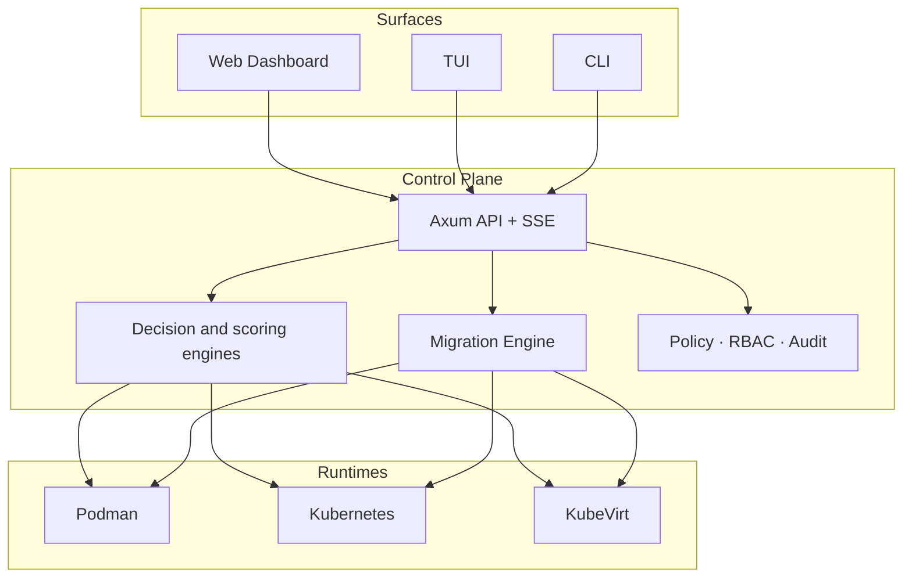

---
hero:
  eyebrow: REFERENCE
  title: Project reference
  tone: sky
  lead: Why Aether exists, how it fits together, the container image, the dashboard and where it sits in the Zyvor stack.
---

This page holds background that used to be in the repository
[README](https://github.com/zyvorai/Aether/blob/main/README.md).

## Why Aether

Most teams write the app once, then rewrite the **deploy story** three times.

| When this happens… | Aether gives you… |
|---|---|
| The same app needs a Podman host, a Kubernetes cluster and a KubeVirt VM | One `aether/v1` Workload YAML with `runtime.allow: [container, kube, kubevirt]` |
| Nobody can say *why* a workload runs where it does | `aether decide --explain` scores the allowed runtimes and gives reasons; `aether explain` describes a deployed workload |
| Moving between runtimes means a rewrite | [Migration](../guides/migration/MIGRATION-INTERNALS.md) between runtimes with immediate, blue-green, rolling or canary strategies, health checks and rollback paths |
| A VM has to move hosts without downtime | KubeVirt live migration, with vGPU-aware validation |
| Every tool has its own console | CLI, terminal UI, web dashboard and REST + SSE API on the same control plane and state |
| Read-only users can do more than read | Admin / Operator / Viewer roles and a hash-checked audit trail |
| Something broke and nobody knows what changed | The [operations desk](../guides/operations/OPERATIONS-DESK.md) and [status board](../guides/operations/STATUS-BOARD.md) |

Aether is not a container orchestrator competing with Kubernetes, and not a
general configuration-management tool.

## How it fits together



| Path | Purpose |
|------|---------|
| `src/` | Control plane: CLI, API, adapters, intelligence |
| `web/dashboard/` | React + TypeScript + Tailwind dashboard |
| `examples/` | Example specs |
| `helm/` · `packaging/` | Cluster and OS packaging |
| `docs/` | Guides, architecture, user manuals |

| Interface | How |
|-----------|-----|
| CLI | `aether run` · `migrate` · `serve` · `live-migrate` · … |
| Terminal UI | `aether tui` |
| API | `http://localhost:5090/api/*` |
| Web | `aether serve`, then open the address it prints |

## Run from the container image

The image `ghcr.io/zyvorai/aether` is private to the Zyvor organisation. To
request access, write to sales@zyvor.dev; the commands below assume access. Using
it needs an Order under the
[Zyvor Production Licence v2.0](https://github.com/zyvorai/Aether/blob/main/LICENSE).

```bash
# Pull
docker pull ghcr.io/zyvorai/aether:0.4.0

# CLI via container (mount state + kubeconfig)
docker run --rm -it \
  -v "$HOME/.aether:/root/.aether" \
  -v "$HOME/.kube:/root/.kube:ro" \
  -v "$(pwd):/work" -w /work \
  ghcr.io/zyvorai/aether:0.4.0 --help

# API and dashboard on :5090
docker run --rm -p 5090:5090 \
  -v "$HOME/.aether:/root/.aether" \
  ghcr.io/zyvorai/aether:0.4.0 serve --host 0.0.0.0 --port 5090
```

The dashboard has a demo login enabled by default. Set `AETHER_DEMO_AUTH=0`, or
your own `AETHER_DEMO_USER` and `AETHER_DEMO_PASSWORD`, before publishing the
port.

## Web dashboard

- Live updates over server-sent events
- [Status board](../guides/operations/STATUS-BOARD.md) with wall mode, and a timeline per workload
- [Operations desk](../guides/operations/OPERATIONS-DESK.md): attention queue, change feed, incidents, explain, preview, revisions, holds and reports
- Command palette: `⌘K` / `Ctrl+K`
- Workload detail: logs, drift and scoring
- Discovered pods and VMs: logs and shell (Operator or Admin)
- Intent debugger with a radar chart for cost, performance, reliability and availability
- Light, dark and system themes

More: [WebUI and REST API guide](WEBUI.md). For frontend work, run
`npm run dev` in `web/dashboard/`.

## Part of the Zyvor stack

| Product | Role next to Aether |
|---|---|
| **Aether** | Runtime portability: one workload spec across Podman, Kubernetes and KubeVirt |
| [Atlas](https://github.com/zyvorai/zyvor-atlas) | Storage control plane; a `persistence.storageClass` of `atlas/<policy>` provisions the volume through Atlas (`AETHER_ATLAS_URL`) |
| [GuestKit](https://github.com/zyvorai/zyvor-guestkit) | Guest VM inspection and tooling, listed in the [ecosystem](../ECOSYSTEM.md) |
| [Zorvia](https://github.com/zyvorai/zyvor-zorvia) | KubeVirt VM platform; pairs with Aether's KubeVirt lane |

Confidential computing (**Ragnarok**) is a separate Zyvor product and is not
shipped in this repository.

## More answers

General questions are in the [documentation FAQ](../documentation.md#faq).
Migration has a [buyer FAQ](../guides/migration/MIGRATION-INTERNALS.md#buyer-faq-10-questions).
Troubleshooting is covered per topic, for example in the
[runbook](../guides/operations/RUNBOOK.md). The
[roadmap](../ROADMAP.md) separates what has shipped from targets.
